# Samanvay (समन्वय)

**One case ledger for every AICTE bureau, cell and Regional Office**: an integrated institution complaint monitoring
and coordination dashboard that finds overlapping matters across units and makes them coordinate before acting.

Smart India Hackathon 2026 · Problem statement **SIH26264** (AICTE Regulation Bureau, Software / Smart Automation) ·
Team Admiral


> All data in this repository is **synthetic**: generated institutions, officials and complaints. No real complainant
> data is included.

## Contents

1. [The problem](#1-the-problem)
2. [Features](#2-features)
3. [System architecture](#3-system-architecture)
4. [Access control and security](#4-access-control-and-security)
5. [Data model](#5-data-model)
6. [How the main flows work](#6-how-the-main-flows-work)
7. [Demo walkthrough](#7-demo-walkthrough)
8. [Getting started](#8-getting-started)
9. [Configuration](#9-configuration)
10. [API overview](#10-api-overview)
11. [Matching benchmark](#11-matching-benchmark-synthetic)
12. [Repository layout](#12-repository-layout)
13. [Status, limitations and production path](#13-status-limitations-and-production-path)

---

## 1. The problem

Complaints about the same technical institution reach AICTE through CPGRAMS, e-mail, letters, referrals and unit
registers, and land in different units: the Regulation Bureau (RB), the Public Grievance Redressal Cell (PGRC), the
Approval Bureau (AB) and the Regional Offices. Each unit keeps its own register, so one unit can issue a show-cause
notice while another is quietly resolving the same grievance, and nobody can say who holds a case or why it is late.

Samanvay keeps **one ledger with one custodian per case**. It recognises the institution behind a free-text complaint,
detects overlapping matters across units, raises **"Potential Overlapping Cases – Coordination Required"**, and checks
before every consequential action whether another unit is already acting.

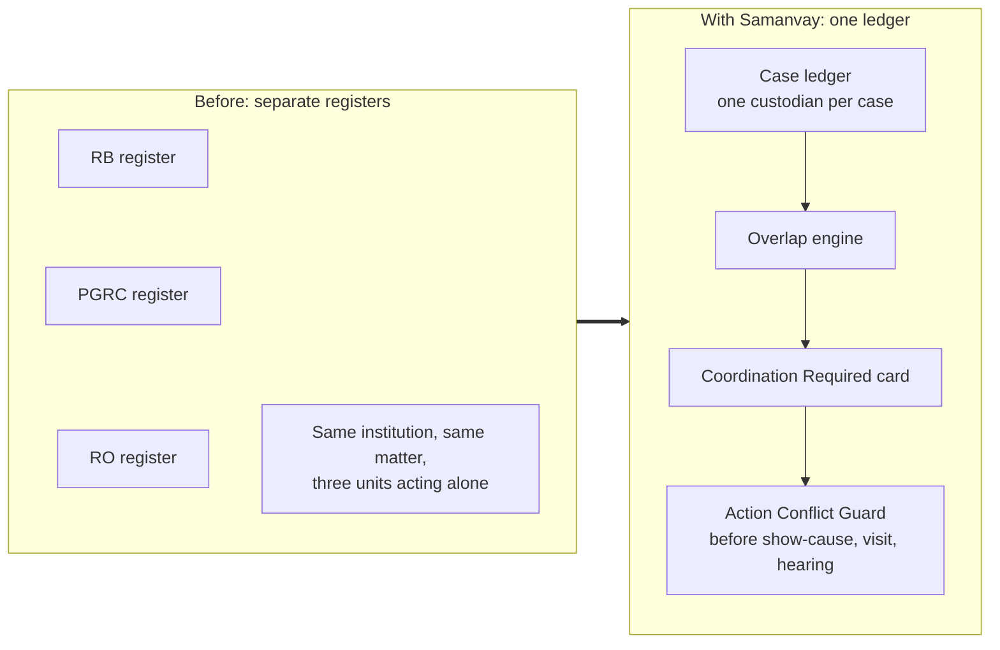

---

## 2. Features

### Unique strengths

| # | Feature | What it does | Where in the app |
|---|---|---|---|
| 1 | **RAG-powered case assistant** | Answers an officer's questions from the case file (only what that officer may see) and Samanvay's configured rules. BM25 retrieval; every sentence cites its source passages, which are shown alongside. Offline by default; can use Claude. | Case → **AI assistant** |
| 2 | **AI-generated case summariser** | A headline, 4–7 cited points and a *missing or overdue* check (no documents, interim reply not sent, undecided coordination, no open task…). | Case → **AI assistant** |
| 3 | **Event-driven notification engine** | Case events write timers and a notification outbox in the same transaction; the worker delivers in-app and e-mail, deduplicated. Notifications never carry complaint text. | Bell, **Notifications** |
| 4 | **SLA and escalation engine** | Versioned SLA policies (DARPG 21-day CPGRAMS rule, 30/90 working days), working-day calendar, reminders, interim-reply prompts, escalation to the unit head, plus a what-if SLA simulator. | Case deadlines, **Cockpit → Timeliness** |
| 5 | **RBAC and bureau-level access control** | 10 roles; three visibility tiers per case (full / metadata / none); sealed categories; enforced in the API **and** by PostgreSQL row-level security. | Everywhere |
| 6 | **Institutional case graph** | Units, cases and overlap links for one institution; cross-unit links drawn strongest; filters and neighbour highlight. | Institution 360 → **Case graph** |
| 7 | **Secure case-linked messaging** | A thread on every case for the units allowed to see it. Insert-only, SHA-256 of each message in the audit chain, access ends when the reason for it ends; a message can become a task. | Case → **Messages** |
| 8 | **Tamper-evident audit trail** | Hash-chained `audit_event` rows, daily Ed25519-signed Merkle checkpoints and a verifier that names the first broken entry. | **Audit** |
| 9 | **Institutional trend analytics** | Monthly received/disposed trends, status by unit/region/category, Institution 360 history, and recurring-issue detection (3+ separate incidents in a year; API `GET /dashboard/recurring` and the AI summary, not yet on a screen). | **Cockpit**, Institution 360 |
| 10 | **API-ready modular architecture** | FastAPI modular monolith with 85 endpoints under `/api/v1`, OpenAPI docs at `/api/docs`, RFC 9457 errors. | `backend/app/modules/*` |

### Core ledger features

| Feature | Summary |
|---|---|
| Unified register and **Register Importer** | Manual intake plus XLSX/CSV import of unit registers and CPGRAMS exports, with column mapping, per-row errors and idempotent re-runs. |
| **Institution identity resolution** | Free-text names in English or Hindi resolve to an AICTE Permanent ID with per-field match evidence; sibling campuses are never merged silently. |
| **Explainable overlap detection** | Hard references → institution → text similarity (n-gram or multilingual embeddings) → shared facts → timing, typed as duplicate / parallel action / related / co-occurrence, with reason codes. |
| **Coordination Required workflow** | Both units see the card; one proposes (relationship, lead unit, joint action), the other confirms; *needs verification* outcome; escalation if undecided. |
| **Action Conflict Guard** | Before a letter, show-cause, committee visit or hearing notice, shows other units' open matters and records the officer's choice and reason. |
| **Custody handshake** | Transfers are proposals; custody moves only when the receiving unit accepts; returns restore the previous status. |
| **Routing check and assistance requests** | Advisory keep / transfer / assist recommendation from unit mandates; assistance lets another unit help while the holder keeps the case. |
| **Case tasks** | Owner unit, officer, due date and dependencies; joint actions and messages become tasks; the earliest due task is the case's next action. |
| **Reports** | Eight reports frozen as snapshots with a SHA-256 checksum; XLSX, PDF and CSV downloads. |
| **Documents** | 25 MB limit, magic-byte check, malware scan (ClamAV), SHA-256, tiered download. |
| **Bilingual** | Hindi complaints are matched against English ones; Hindi labels for navigation and common actions. |

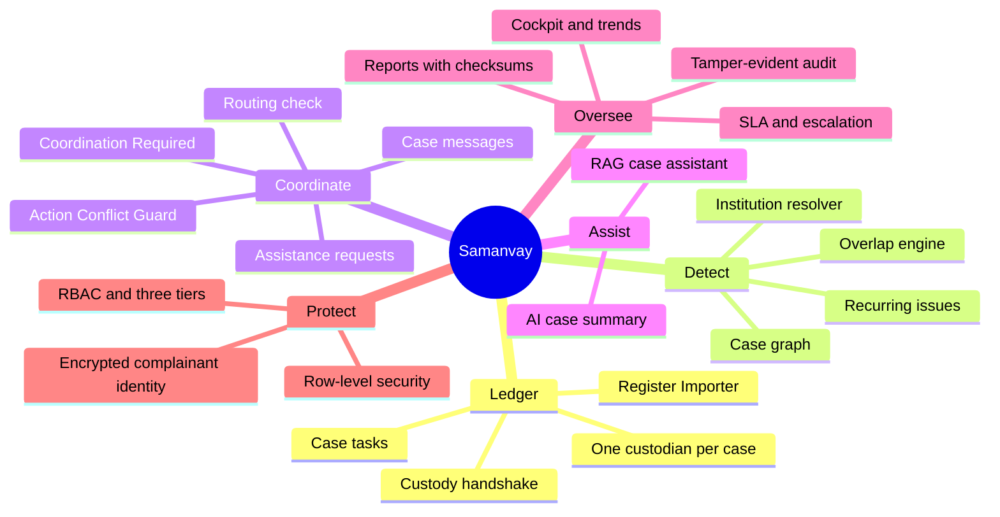

---

## 3. System architecture

### Context

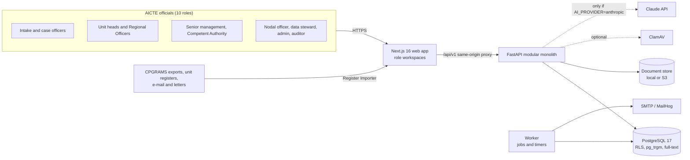

### Backend modules

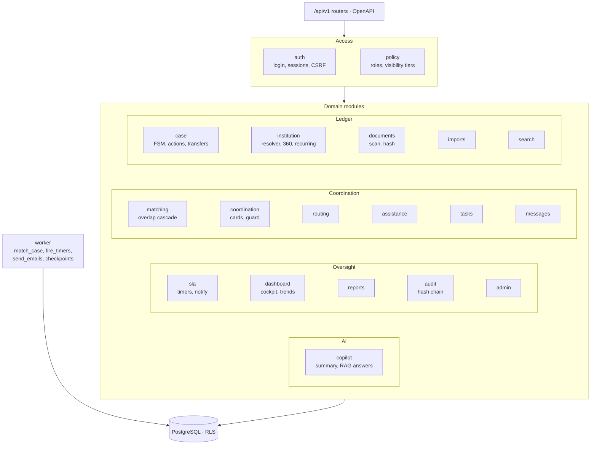

Modules talk through service functions, not each other's tables (read-only joins for search and dashboards excepted).

### Tech stack

| Layer | Choice |
|---|---|
| Web | Next.js 16 (App Router), React 19, TypeScript 5.9, Tailwind CSS 4, Radix, Motion, SWR, react-hook-form + zod |
| API | FastAPI 0.162, Python 3.12, SQLAlchemy 2.1, Pydantic 2, Alembic |
| Database | PostgreSQL 16/17 with row-level security, `pg_trgm`, `unaccent`, `pgcrypto`, full-text search |
| Jobs | Postgres `job` and `timer` tables claimed with `FOR UPDATE SKIP LOCKED`; one worker process |
| Matching | rapidfuzz, numpy, character n-grams or `paraphrase-multilingual-MiniLM-L12-v2` embeddings |
| AI | In-house BM25 retrieval; optional Claude (`anthropic` SDK, `claude-opus-5-5`) |
| Security | Argon2id, JWT in httpOnly cookie bound to a revocable session, double-submit CSRF, Fernet column encryption, Ed25519 |
| Reports | openpyxl (XLSX), reportlab (PDF), CSV |
| Tooling | uv, pnpm, ruff, pytest + Hypothesis, Vitest, Playwright, Docker Compose, GitHub Actions |

---

## 4. Access control and security

### Request lifecycle

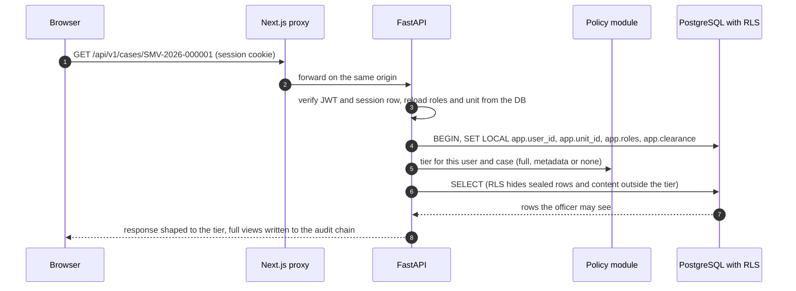

### Visibility tiers

| Tier | Who | Sees |
|---|---|---|
| **full** | Holding unit; unit offered the case by transfer; units coordinating on a related case; units with an open assistance request; Competent Authority; senior management and auditors (non-sealed); Regional Officer for their region; time-boxed grants | Everything, including complaint text, documents, messages and (on recorded reason) the decrypted complainant identity |
| **metadata** | Any other official with a case-viewing role | Case number, institution, category, holding unit and officer, status, dates, overlap flags |
| **none** | Users without clearance, for sealed categories | The case does not exist for them; the guard only says "a restricted matter exists" |

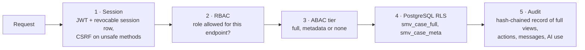

Other controls: Argon2id passwords with lockout; complainant name and contact encrypted per column (matching uses an
HMAC); uploads type-checked, scanned and hashed; security headers and a strict CORS allow-list; JSON logs without bodies
or personal data; the API and worker database roles cannot update or delete audit rows or messages.

### Tamper-evident audit chain

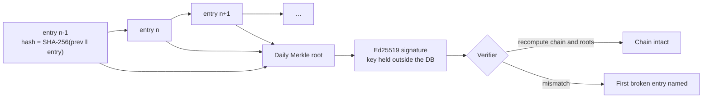

---

## 5. Data model

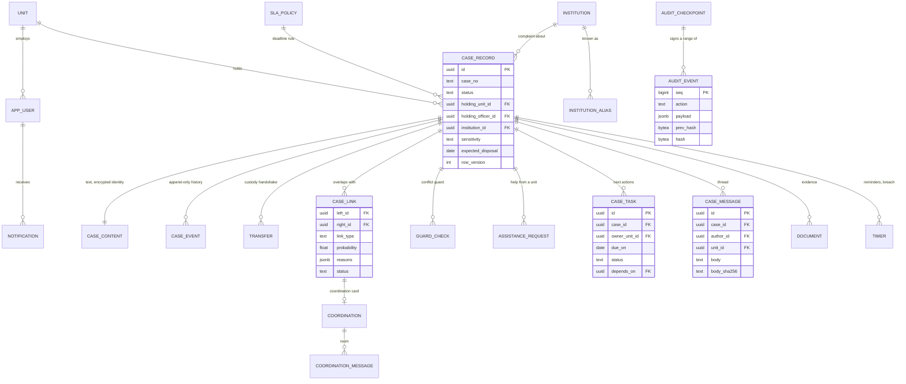

Migrations: `0001` schema, RLS functions and policies; `0002` reference data (categories, transitions, SLA policies,
calendar); `0003` routing directory and assistance; `0004` case tasks; `0005` case messages.

---

## 6. How the main flows work

### Case lifecycle

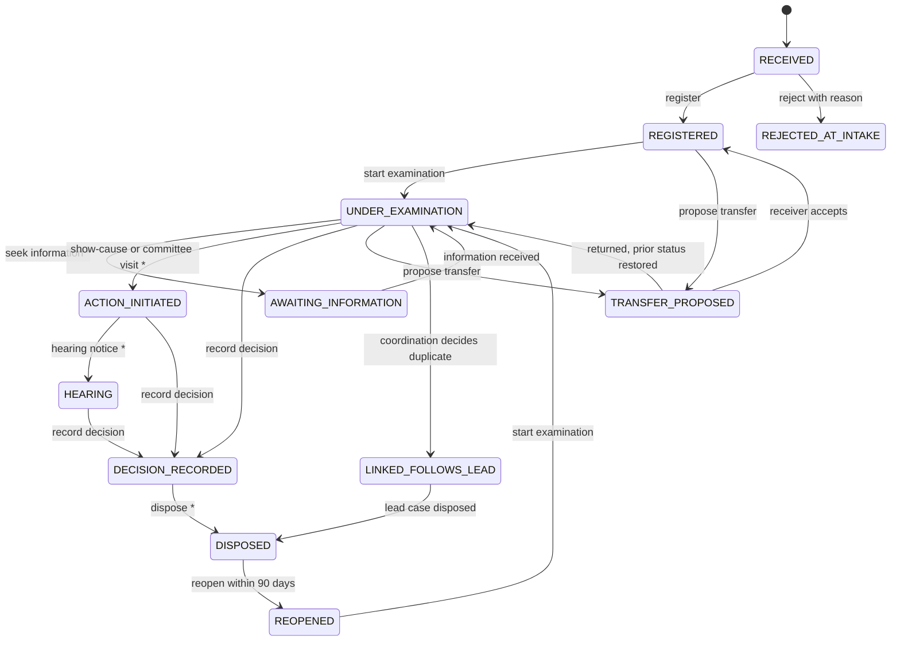

`*` marks a consequential action: the Action Conflict Guard runs first. Transitions, allowed roles, mandatory remarks
and the consequential flag are rows in `transition_rule`, so rules change without a redeploy. Nothing closes
automatically.

### Overlap detection cascade

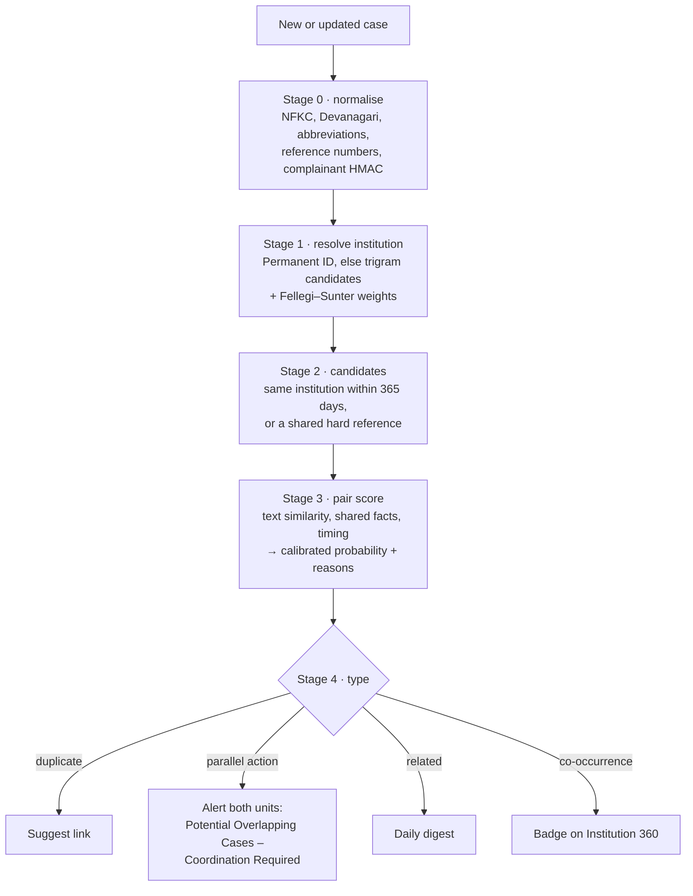

The scoring core is shared by the live worker and the benchmark harness, so benchmark numbers describe the code that
runs. If the embedding model is missing, the engine falls back to n-grams and says so on every card.

### Coordination and the Action Conflict Guard

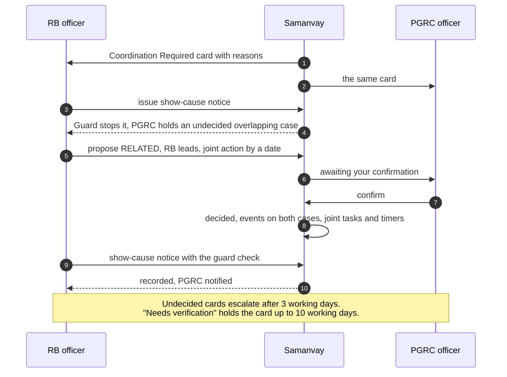

### Routing check and assistance

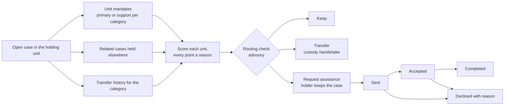

### Secure case-linked messaging

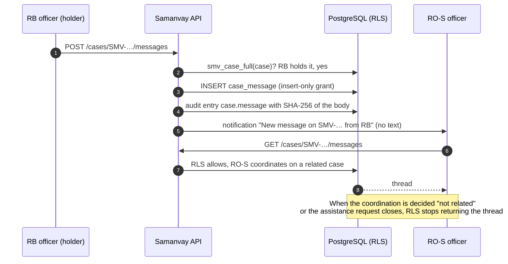

### Case assistant (summary and RAG Q&A)

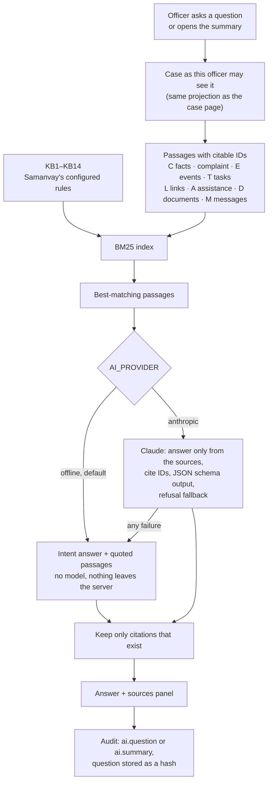

A metadata-tier officer gets no complaint text, documents or messages in the passages, so the assistant cannot reveal
more than the case page.

### Event-driven notifications and SLA timers

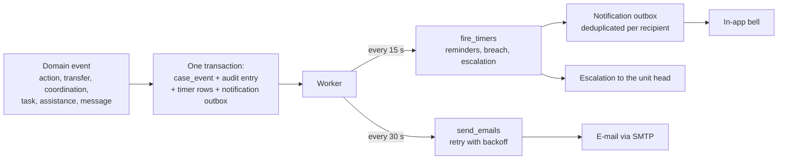

A CPGRAMS grievance received on 1 October, under the 21-calendar-day DARPG rule:

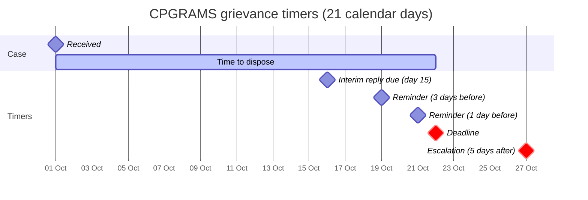

### Deployment (Docker Compose)

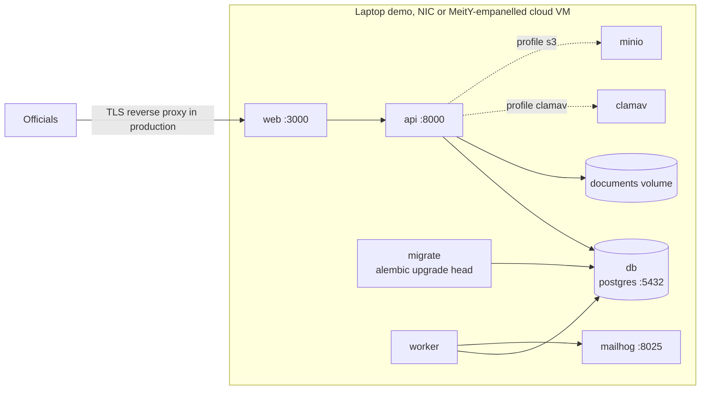

The API image bakes in the multilingual embedding model (`WITH_EMBEDDINGS=true`, CPU-only torch), so Hindi–English
matching works with no network at demo time.

---

## 7. Demo walkthrough

About 8 minutes, on the seeded demo data. With `DEMO_MODE=true` the sign-in page lists one-click demo officials for
every role.

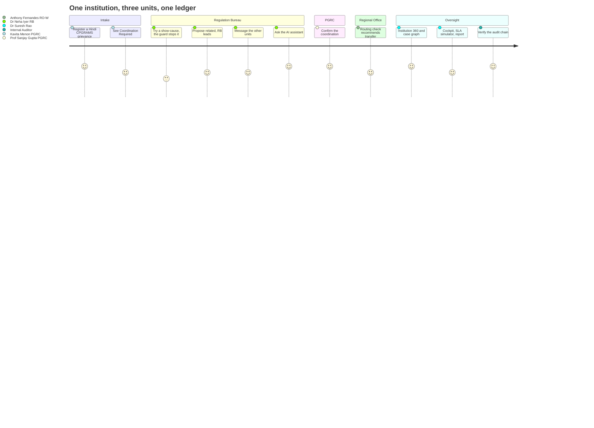

1. **Intake with a Hindi complaint.** Sign in as **Kavita Menon (PGRC intake)** → *New case* → **Load demo CPGRAMS
   grievance (Hindi)**. The resolver picks Sahyadri Valley Institute of Engineering, **Nashik**, and shows the Pune
   sibling campus with the reason it lost. Register.
2. **Overlap found.** The case opens with **Potential Overlapping Cases – Coordination Required — RB holds
   SMV-2026-000001**.
3. **Action Conflict Guard.** Switch to **Dr Neha Iyer (RB)** → open SMV-2026-000001 → **Issue show-cause notice**. The
   guard lists the PGRC grievance and the Western RO matter → *Coordinate first*.
4. **Coordinate.** In the coordination card propose **Related, RB leads**, with a joint action and date. Switch to
   **Prof. Sanjay Gupta (PGRC)** and confirm. The joint action becomes a task on both cases.
5. **Message the units.** Back as RB, open SMV-2026-000001 → **Messages**. The side panel lists who can read the thread
   and why; send a message, then *Make a task* from it. The other unit's notification names the case, not the text.
6. **Ask the AI assistant.** **AI assistant** tab: read the cited summary and its *missing or overdue* list, then ask
   *"What happens if I issue a show-cause notice now?"* and *"When is this case due?"*. Select a citation chip to see
   the source passage.
7. **Routing and assistance.** As **Anthony Fernandes (Western RO)** open SMV-2026-000002: the routing check recommends
   a transfer to RB with reasons and alternatives. On SMV-2026-000001, RB keeps the case and has already asked the
   Approval Bureau for help (A-2026-00001, completed). On C-2026-00001, *Needs verification* records what to check.
8. **Institution 360.** Open 1-9990001234: cases across units and custodians, the
   **Case graph** (select a case to highlight its links) and the history timeline.
9. **Oversight.** As **Dr Suresh Rao (Adviser)** → *Management Cockpit*: tiles drill down to the exact cases; replay a
   15-day CPGRAMS target in the SLA simulator; generate a monthly report and note its SHA-256.
10. **Audit.** As **Internal Auditor** → *Audit* → *Verify chain*. To show tamper detection, edit one
    `audit_event.payload` row as the schema owner and verify again: the first broken entry is named.
11. **Benchmark.** *Matching benchmark* shows the baselines against the cascade, per overlap kind, with caveats.

Files to import live: [samples/rb_register_sample.xlsx](samples/rb_register_sample.xlsx) (300 rows, 9 overlapping
PGRC matters, 3 deliberately bad rows) and [samples/cpgrams_export_sample.csv](samples/cpgrams_export_sample.csv).

---

## 8. Getting started

### Run locally (no Docker)

Requirements: PostgreSQL ≥ 16 with a superuser for your OS user, Python 3.12 via [uv](https://docs.astral.sh/uv/),
Node 24 with pnpm.

```bash
python3 scripts/gen_env.py
```

```bash
cd backend && uv sync --extra embeddings && cd ../frontend && pnpm install && cd ..
```

```bash
./scripts/db_reset.sh --yes
```

`db_reset.sh` creates the three database roles, migrates and loads the demo (about 3,000 cases and 400 institutions,
1–2 minutes). It **drops the local `samanvay` database first** and refuses to run when `APP_ENV=production`.

```bash
./scripts/dev.sh
```

Open http://localhost:3000. The demo password for the sign-in form is `SEED_DEMO_PASSWORD` in your `.env`.

### Run with Docker Compose

Seed first (the seed refuses to run while a worker is connected), then start everything:

```bash
docker compose -f infra/docker-compose.yml --env-file .env run --rm api python -m app.ml.seed
```

```bash
docker compose -f infra/docker-compose.yml --env-file .env up -d --build
```

Web on :3000, API on :8000 (OpenAPI at `/api/docs` outside production), MailHog on :8025. Add `--profile clamav` for
real malware scanning and `--profile s3` for MinIO storage.

### Tests and checks

```bash
cd backend && uv run pytest -o addopts="" -q
```

```bash
cd backend && uv run ruff check app tests migrations && uv run python -m app.ml.benchmark
```

```bash
cd frontend && pnpm lint && pnpm typecheck && pnpm test && pnpm build
```

```bash
cd frontend && pnpm e2e
```

The backend tests build a separate `samanvay_test` database from the real migrations, because row-level security is
part of what is tested. `pnpm e2e` runs browser journeys against its own API and web server (ports 8001 / 3001) and a
throwaway copy of the demo database.

---

## 9. Configuration

`scripts/gen_env.py` writes a `.env` with generated secrets; [.env.example](.env.example) documents every variable.

| Variable | Default | Purpose |
|---|---|---|
| `APP_ENV` | `development` | `development`, `test`, `demo` or `production` (production refuses demo mode and weak keys) |
| `DEMO_MODE` | `true` | One-click role switching on the sign-in page |
| `DATABASE_URL`, `WORKER_DATABASE_URL`, `MIGRATION_DATABASE_URL` | local | API role (RLS enforced), worker role (bypasses RLS for matching), schema owner |
| `JWT_SECRET`, `FIELD_ENCRYPTION_KEY`, `HMAC_KEY`, `AUDIT_SIGNING_KEY` | generated | Sessions, complainant encryption, complainant matching, audit signatures |
| `TEXT_BACKEND` | `embedding` | `embedding` (Hindi–English) or `ngram` |
| `STORAGE_BACKEND` | `local` | `local` or `s3` |
| `SCANNER` | `builtin` | `builtin` (EICAR test only) or `clamav` |
| `SMTP_HOST` | unset | E-mail notifications; unset skips e-mail |
| `AI_PROVIDER` | `offline` | `offline` (retrieval + rules, nothing leaves the server) or `anthropic` |
| `AI_MODEL` | `claude-opus-5-5` | Claude model when `AI_PROVIDER=anthropic`; needs `ANTHROPIC_API_KEY` |

---

## 10. API overview

All routes are under `/api/v1`; interactive docs at `/api/docs` outside production. Errors follow RFC 9457.

| Area | Main routes |
|---|---|
| Auth | `POST /auth/login`, `POST /auth/logout`, `GET /auth/me`, `GET /auth/csrf`, demo login |
| Cases | `GET/POST /cases`, `GET /cases/{ref}`, `POST /cases/{ref}/actions`, `/notes`, `/assign`, `/institution`, `/complainant` |
| Custody | `POST /cases/{ref}/transfers`, `GET /transfers`, `POST /transfers/{id}/accept`, `/return` |
| Coordination | `GET /coordination`, `GET /coordination/{code}`, `/decision`, `/confirm`, `/verification`, `/escalate`, `/messages` |
| Conflict guard | `POST /cases/{ref}/guard-check`, `POST /guard-checks/{id}/choice` |
| Routing and assistance | `GET /routing/directory`, `POST /cases/{ref}/assistance`, `GET /assistance`, `/accept`, `/decline`, `/complete`, `/cancel` |
| Tasks | `POST /cases/{ref}/tasks`, `GET /tasks`, `POST /tasks/{id}/complete`, `/cancel` |
| Messages | `GET/POST /cases/{ref}/messages`, `POST /cases/{ref}/messages/{id}/task` |
| Assistant | `POST /cases/{ref}/assistant/summary`, `POST /cases/{ref}/assistant/ask`, `GET /assistant/status` |
| Institutions | `GET /institutions`, `GET /institutions/{pid}`, `POST /institutions/resolve`, `POST /institutions/{pid}/aliases` |
| Dashboards | `GET /dashboard/summary`, `/analytics`, `/desk`, `/recurring`, `POST /simulations/sla` |
| Documents | `POST /cases/{ref}/documents`, `GET /documents/{id}` |
| Reports | `GET /reports/catalogue`, `GET/POST /reports`, `GET /reports/{id}/download` |
| Imports | `POST /imports/preview`, `POST /imports`, `GET /imports/{id}`, `GET /imports/profiles` |
| Notifications and SLA | `GET /me/notifications`, `POST /notifications/{id}/read`, `GET/POST /sla-policies` |
| Admin and audit | `GET/POST /admin/users`, `GET /admin/access-review`, `GET /audit`, `POST /audit/verify`, `POST /audit/checkpoint` |

---

## 11. Matching benchmark (synthetic)

3,000 generated complaints about 400 institutions, 300 labelled true overlap pairs, 300 hard negatives, 227 Hindi
complaints. Labels are kept outside the application database. Results: [ml/benchmark/](ml/benchmark/).

| System | Precision | Recall | F1 | Hindi–English recall |
|---|---|---|---|---|
| B0 · exact Permanent ID + category within 90 days | 0.559 | 0.380 | 0.452 | 0.440 |
| B1 · + fuzzy institution name | 0.500 | 0.717 | 0.589 | 0.960 |
| **Samanvay cascade, n-gram text** | **0.896** | **0.807** | **0.849** | 0.293 |
| **Samanvay cascade, multilingual embeddings** | **0.932** | **0.870** | **0.900** | 0.667 |

Institution resolution: auto-resolve precision 1.000, top-3 recall 0.999, 0 sibling-campus false merges, 34% routed to
an officer.

The benchmark is synthetic and was generated by the same team. It proves the mechanism and the measurement, not
real-world accuracy.

---

## 12. Repository layout

```
backend/
  app/core/          config, DB sessions + RLS context, security, errors, middleware
  app/modules/       auth, policy, case, institution, matching, coordination, routing, assistance, tasks,
                     messages, copilot (AI), sla, dashboard, search, documents, imports, reports, audit, admin
  app/ml/            synthetic data generator, benchmark harness, demo seed
  migrations/        Alembic 0001–0005 (schema, RLS, reference data, routing, tasks, messages)
  tests/             pytest against a real PostgreSQL
frontend/
  app/(app)/         role workspaces: desk, worklist, cases, coordination, assistance, transfers, institutions,
                     cockpit, reports, imports, notifications, admin, audit, benchmark, settings
  components/        UI kit, case dialogs, tasks, routing, case messages, case assistant, case graph
  tests/, e2e/       Vitest unit tests and Playwright journeys
ml/benchmark/        benchmark results and labels
infra/               docker-compose stack and Postgres role bootstrap
scripts/             env generation, DB reset, native dev runner, e2e database
samples/             import files and the live demo complaint
docs/                architecture, tech stack, frontend, implementation status
```

More detail: [docs/ARCHITECTURE.md](docs/ARCHITECTURE.md), [docs/TECH_STACK.md](docs/TECH_STACK.md),
[docs/FRONTEND.md](docs/FRONTEND.md), [docs/IMPLEMENTATION_STATUS.md](docs/IMPLEMENTATION_STATUS.md).

---

## 13. Status, limitations and production path

**Verified (28 Oct 2026):** 65 backend tests pass against PostgreSQL 17; frontend typecheck, lint and 25 Vitest tests
pass; the new messaging, assistant and graph features were walked through in a browser.

**Known limitations**

- The **Claude path of the case assistant has not been run against the live API**; the default offline mode composes
  answers from retrieved passages with rules. Its knowledge base restates Samanvay's configured rules, not regulation text.
- All benchmark numbers come from synthetic data.
- Statuses, categories, timelines, sealed categories, unit mandates and the list of consequential actions are
  *proposed* and need AICTE sign-off.
- Notifications refresh by polling (15–30 s), not push. Rate limiting is in-process (one API replica).
- Hindi strings cover navigation and common actions only; an axe-core and screen-reader pass has not been run.

**Production prerequisites (not done here):** OIDC single sign-on (NIC Parichay), TLS termination, keys in a KMS/HSM,
ClamAV, S3-compatible storage on NIC or a MeitY-empanelled cloud, WAL-archived backups with tested restore, NTP sync
with NIC/NPL, 180-day log retention (CERT-In) and a CERT-In-empanelled security audit.
