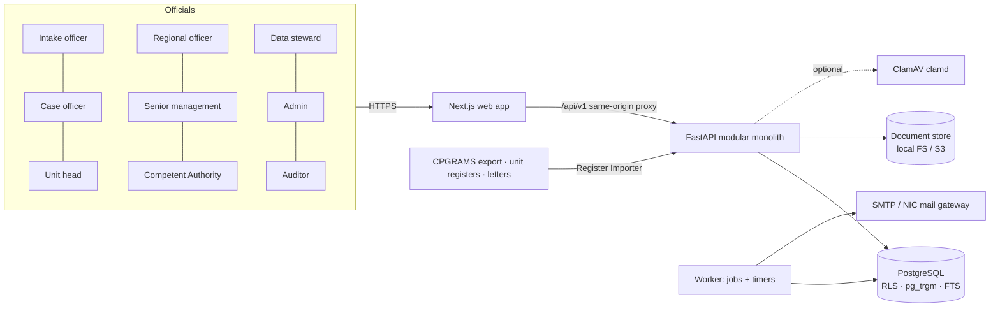
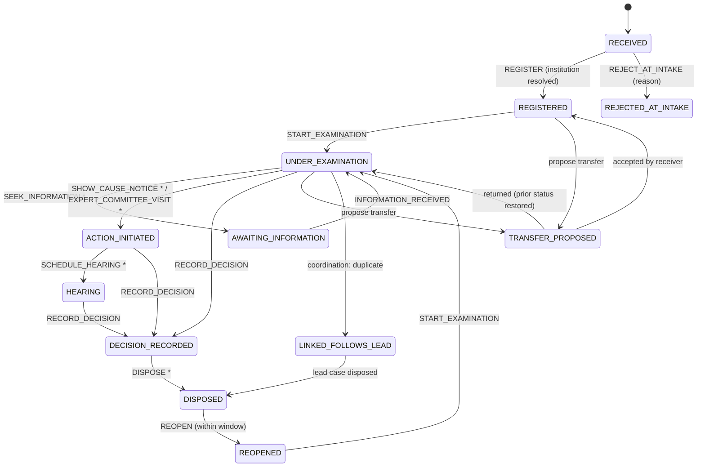
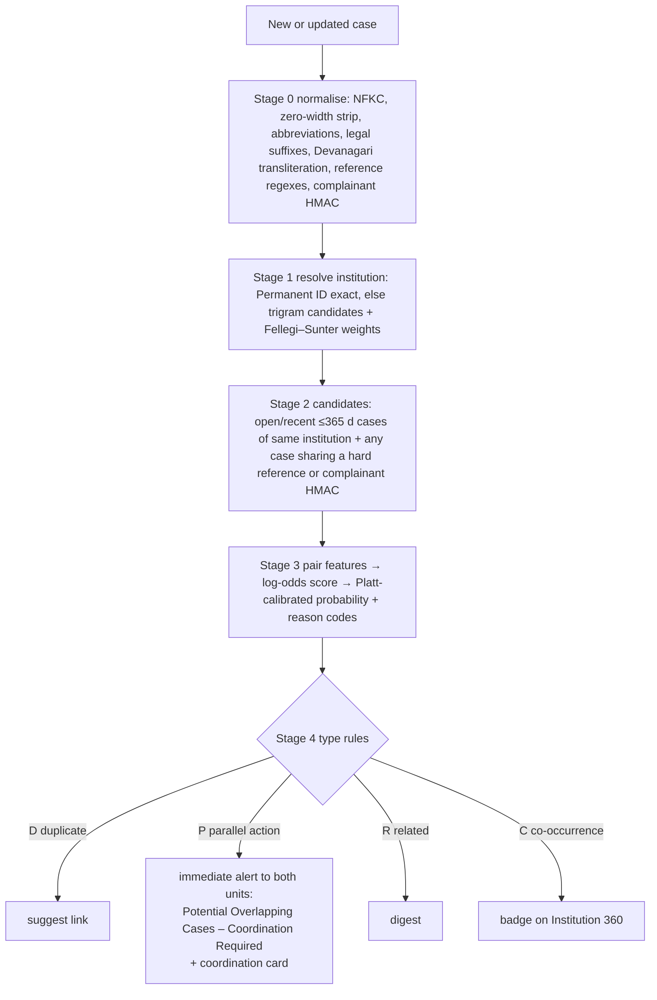
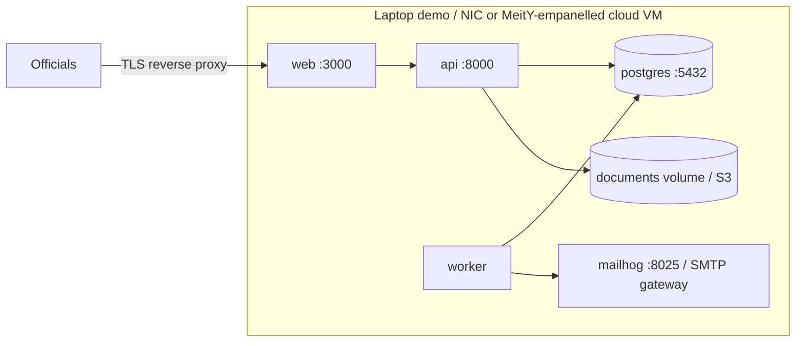

# Samanvay — Architecture

Samanvay (समन्वय, "coordination") is a single case ledger for AICTE bureaus, cells and Regional Offices.
The dashboard reads the ledger; the ledger's custody, coordination and conflict-guard rules are what change behaviour.

## 1. System context



## 2. Components and module boundaries

```
backend/app/
  core/          config, db (sessions + RLS context), security (passwords, JWT, CSRF), errors (RFC 9457), rate limit, logging
  modules/
    auth/        login, logout, session, demo role switch
    policy/      roles, visibility tiers, permission checks (RBAC + ABAC)
    case/        case ledger, FSM (transition_rule table), actions, custody handshake (transfers), assignment
    institution/ master, aliases, resolver (Fellegi–Sunter scorer)
    matching/    normalisation, reference extraction, text similarity backends, pair scoring, typing, alert policy
    coordination/ coordination cards, two-party decisions, lead unit, room, escalation, Action Conflict Guard
    sla/         working-day calendar, versioned policies, timers, notifications outbox, e-mail sender
    documents/   upload pipeline (size, magic bytes, scan, hash), storage backends
    search/      typed-token query parser, filters, fuzzy + full-text search
    dashboard/   cockpit rollups, desk worklist, SLA what-if simulator
    reports/     report catalogue, frozen snapshots + checksum, XLSX/PDF/CSV renderers
    imports/     register importer (mapping profiles, validation, idempotency, row report)
    audit/       hash chain, Merkle checkpoints (Ed25519), verifier
    admin/       users, units, categories, SLA policies, invariants
  ml/            synthetic data generator, benchmark harness (B0, B1, Samanvay)
  worker.py      job runner + periodic timers
```

Rules enforced in code review: modules talk through service functions, never through each other's tables, except read-only joins for search and dashboards.

## 3. Request lifecycle and access control

```mermaid
sequenceDiagram
  participant B as Browser
  participant N as Next.js proxy
  participant A as FastAPI
  participant P as Policy module
  participant D as PostgreSQL (RLS)
  B->>N: GET /api/v1/cases/123 (cookie smv_session)
  N->>A: forward (same origin)
  A->>A: verify JWT + session row not revoked; load user, roles, unit fresh from DB
  A->>D: BEGIN; SET LOCAL app.user_id/app.unit_id/app.roles/app.clearance
  A->>P: tier = visibility(user, case)  (full | metadata | none)
  A->>D: SELECT ... (RLS hides sealed rows and content rows outside the tier)
  A-->>B: response projected to tier; full-content views written to audit
```

Three visibility tiers per case (blueprint SOL-12):

| Tier | Who | What |
|---|---|---|
| full | holding unit; receiving unit of a pending transfer; active coordination participants; senior management and Competent Authority (non-sealed); regional officers for their region; auditor (read-only, logged); explicit time-boxed grants | everything incl. complaint body and (decrypted) complainant contact |
| metadata | any other official with a case-viewing role | case no, institution, category, holding unit/officer, status, dates, overlap flags |
| none | sealed categories for users without clearance | the row does not exist for them; the Action Conflict Guard says only "restricted matter exists" |

Enforcement is layered: the policy module decides and shapes responses; Postgres RLS enforces again
(`case_record` hides sealed rows, `case_content` only returns rows in the full tier). The API connects as
`samanvay_app` (RLS enforced); the worker connects as `samanvay_worker` (`BYPASSRLS`) because matching must
see every case to find overlaps — its *outputs* (alerts) are filtered by recipient scope.

## 4. Case lifecycle (custody state machine)



`*` = consequential action → the Action Conflict Guard runs first. Transitions, allowed roles, mandatory remarks and
the consequential flag are rows in `transition_rule`. Custody changes only through the two-step transfer handshake.

PS reporting categories are computed: Pending = REGISTERED, AWAITING_INFORMATION, REOPENED (+ RECEIVED);
Under process = UNDER_EXAMINATION, ACTION_INITIATED, HEARING, DECISION_RECORDED, LINKED_FOLLOWS_LEAD;
Disposed = DISPOSED (REJECTED_AT_INTAKE separately); Transferred = TRANSFER_PROPOSED; Escalated = flag; Overdue = open and past expected disposal.

## 5. Overlap detection cascade



The scoring core (`app/modules/matching/scoring.py`) is pure Python and is shared by the live worker and the benchmark harness,
so benchmark numbers describe the code that runs in production. Text similarity is pluggable; if the embedding backend is
unavailable the engine records "text not compared" and scores on the remaining features (blueprint fallback A+).

## 6. Coordination and the Action Conflict Guard

```mermaid
sequenceDiagram
  participant RB as RB officer
  participant API
  participant PG as PGRC officer
  API->>RB: card "Potential Overlapping Cases – Coordination Required" (P 0.91, reasons)
  API->>PG: same card
  RB->>API: propose RELATED, lead=RB, joint due 30 Oct
  API->>PG: awaiting your confirmation
  PG->>API: confirm
  API->>API: coordination DECIDED; events on both cases; joint-deadline timers
  RB->>API: guard-check SHOW_CAUSE_NOTICE
  API-->>RB: COORDINATED (other matter decided, PGRC follows RB)
  RB->>API: action SHOW_CAUSE_NOTICE + guard_check_id
```

If units do not decide within 3 working days the coordination escalates (timer) to the nodal officer / Competent Authority.
Every consequential action stores a `guard_check` row: the overlaps found, the officer's choice (open coordination,
proceed and notify, cancel) and a mandatory reason when proceeding past an undecided overlap.

## 7. Asynchronous work

| Job kind | Trigger | Notes |
|---|---|---|
| `match_case` | case created / institution resolved / text changed | idempotent upsert of `case_link` rows; rejected pairs stay rejected unless a new hard reference appears |
| `import_register` | file uploaded | per-row savepoints, row-level error report, idempotent on `(channel, source_ref)` |
| `generate_report` | user request | snapshot frozen first, rendered on download |
| periodic `fire_timers` | every 15 s | SLA reminders/breach/escalation, interim reply, transfer and coordination escalation |
| periodic `send_emails` | every 30 s | outbox, exponential backoff, 5 attempts |
| periodic `audit_checkpoint` | daily (and on demand) | Merkle root over new audit hashes, Ed25519 signature |
| periodic `invariants` | hourly | open cases without a holding officer, stuck transfers |

The `job` table is claimed with `FOR UPDATE SKIP LOCKED`; failures back off exponentially and dead-letter after `max_attempts`.

## 8. Data model (main tables)

`region`, `unit`, `app_user`, `user_session`, `institution`, `institution_alias`, `category`, `category_compat`,
`transition_rule`, `case_record` (metadata + custody), `case_content` (body, encrypted complainant contact, tsvector — RLS),
`case_event` (append-only), `transfer`, `access_grant`, `document`, `case_link`, `coordination`, `coordination_message`,
`guard_check`, `sla_policy`, `calendar_day` (working-day index), `holiday`, `timer`, `notification`, `job`,
`import_job`, `mapping_profile`, `text_vector`, `matching_model`, `report_snapshot`, `audit_event`, `audit_checkpoint`.

Transaction boundaries (blueprint §20.4): case state change + event + audit + timer recalculation in one transaction;
transfer propose/accept + custody + audit in one; link decision + coordination + audit in one; guard result + action in one.
Matching, notifications delivery, imports and report rendering are asynchronous.

## 9. Security controls in code

- Argon2id password hashes; login lockout after 5 failures (15 min); per-IP login rate limit.
- JWT (HS256, 30 min sliding) in `httpOnly`, `SameSite=Lax` cookie bound to a server-side session row (revocable); double-submit CSRF token on every unsafe method.
- Roles and unit re-read from the database on every request; tokens carry no authority.
- RBAC per endpoint + ABAC tiers + Postgres RLS; deny by default.
- Complainant name/contact encrypted at column level (Fernet, key from env); matching uses an HMAC of phone/e-mail.
- Uploads: 25 MB limit, magic-byte allow-list, scanner (ClamAV or built-in EICAR check in dev only), SHA-256 recorded in the audit chain, `Content-Disposition: attachment` + `nosniff` on download.
- Security headers, strict CORS allow-list, RFC 9457 errors without internals, request IDs, JSON logs with no bodies or PII.
- E-mail and notifications carry case numbers and links only, never complaint text.
- Audit table: the API/worker DB roles have INSERT/SELECT only; hash chain + signed checkpoints detect edits by anyone with DB access.

## 10. Deployment



`infra/docker-compose.yml` runs the stack; `scripts/dev.sh` runs it natively (local Postgres) when Docker is unavailable.
Production prerequisites: TLS termination, OIDC (Parichay), KMS-held keys, ClamAV, S3-compatible storage, backups with
WAL archiving, NTP sync with NIC/NPL, 180-day log retention (CERT-In), CERT-In empanelled security audit.
